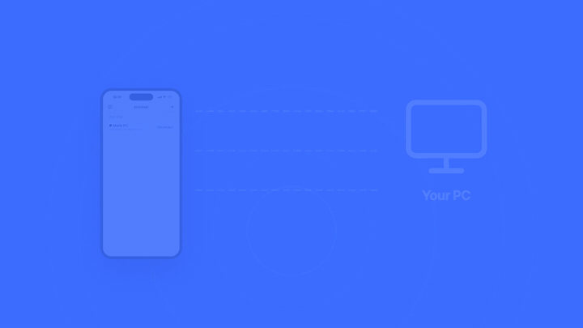

# phoneset

[](https://skills.sh/mehmetraufoguz/phoneset)

Use your phone as your PC's **microphone**, **headphones** and **webcam** over Wi-Fi.

The iPhone app is on the [App Store](https://apps.apple.com/app/id6828815833) (a paid app; the webcam is a
subscription inside it). The PC program and the source of both are here.

<p align="center">
  
</p>

```
 phone mic ──Wi-Fi──▶ phoneset (PC, terminal) ──▶ virtual cable ──▶ any app's microphone
 phone speaker ◀──Wi-Fi── phoneset (PC, terminal) ◀── what the PC is playing
 phone camera ──Wi-Fi──▶ phoneset (PC, terminal) ──▶ "phoneset Camera" ──▶ any video app
```

|                    |                                                                                                              |
| ------------------ | ------------------------------------------------------------------------------------------------------------ |
| `pc/`              | The PC side. A Go program you run in a terminal, no window. Windows and macOS.                               |
| `mobile/`          | The phone app. Expo (SwiftUI on iOS, Jetpack Compose on Android through Expo UI), logic written with Effect. |
| `scripts/`         | `install-mac.sh` and `install-windows.ps1` (one-line installs) and `icons.py` (draws the icon).              |
| `macos/`           | The virtual camera for macOS: a camera extension and its helper app, `phoneset Camera.app`.                   |
| `windows/`         | The virtual camera for Windows: a DirectShow camera (from softcam) and `phoneset-camera.exe`.                 |
| `skills/`          | An agent skill: how to install, use and troubleshoot phoneset (`npx skills add mehmetraufoguz/phoneset`).    |
| `docs/protocol.md` | The wire protocol and its security model.                                                                    |
| `docs/virtual-camera.md` | The virtual camera: how it fits together, what was run and what was not (numbers: `docs/webcam-measurements.md`). |

## Using it

### 1. On the PC

#### Windows 10/11

One line in PowerShell (no administrator rights; downloads the latest release, puts `phoneset.exe` in
`%LOCALAPPDATA%\phoneset\bin` and adds that folder to your user `PATH`):

```powershell
irm https://raw.githubusercontent.com/mehmetraufoguz/phoneset/main/scripts/install-windows.ps1 | iex
```

With options (`-Start` runs it in the background now, `-Autostart` starts it at every login, `-WithVBCable`
also installs the virtual microphone through winget, `-Version v0.1.0` picks a release):

```powershell
& ([scriptblock]::Create((irm https://raw.githubusercontent.com/mehmetraufoguz/phoneset/main/scripts/install-windows.ps1))) -Start -Autostart -WithVBCable
```

You can also download `phoneset-windows-amd64.zip` (or `-arm64`) from the
[latest release](https://github.com/mehmetraufoguz/phoneset/releases/latest) and unpack `phoneset.exe`, or build it:

```sh
pnpm pc:build:windows        # from a Mac/Linux box
cd pc && go build -o phoneset.exe ./cmd/phoneset   # on Windows
```

Install **[VB-CABLE](https://vb-audio.com/Cable/)**. Windows can't create a microphone
out of thin air, so phoneset plays your phone's voice into the cable's _CABLE Input_,
and apps record from its other end, _CABLE Output_. Pick **CABLE Output** as the
microphone in Discord, Teams, OBS, Windows Sound settings, and so on.

Then run it:

```
phoneset
```

It prints a QR code and a 6-digit code. Allow it through the Windows firewall for
_private networks_ the first time (it listens on TCP 47831 and announces itself over mDNS).

Typing in the window: `p` pair another phone, `l` list phones, `a` audio devices, `q` quit.

**Headphones.** phoneset captures what a playback device is playing and streams it to
the phone (WASAPI loopback). By default that is the system default device, so the PC's
own speakers keep playing too. Either turn the PC speakers down (on most drivers the
loopback tap ignores the speaker volume, but that depends on the driver) or send audio to
a second virtual cable and capture that: `phoneset --speaker-device "CABLE-A Input"`. The
device that carries the phone's microphone can't also be the headphone source, because that
would echo your voice back to you; phoneset refuses that combination and says so.

```
phoneset audio                       list devices and how phoneset would use them
phoneset test                        level meter for what would be sent to the phone
phoneset test --mic                  quiet tone into the microphone cable, to check it
phoneset phones                      list paired phones
phoneset forget <name|id|all>
phoneset --mic-device "CABLE"        which device carries the phone's microphone
phoneset --speaker-device "Speakers" which device is sent to the phone
phoneset --no-mic | --no-speaker
phoneset --pair                      show the pairing QR even if phones are paired
phoneset --port 47831 --name "Desk PC" --config-dir DIR --verbose
```

Pairings are stored in `%AppData%\phoneset\`.

#### macOS (12 or later)

With [Homebrew](https://brew.sh) (the formula lives in [homebrew-tap](https://github.com/mehmetraufoguz/homebrew-tap)):

```sh
brew install mehmetraufoguz/tap/phoneset
brew install blackhole-2ch    # the virtual microphone, see below
```

Or one line (downloads the latest release, installs `phoneset` to `~/.local/bin`, adds it to your `PATH`):

```sh
curl -fsSL https://raw.githubusercontent.com/mehmetraufoguz/phoneset/main/scripts/install-mac.sh | sh -s -- --start
```

`--start` runs it in the background right away, `--autostart` also starts it at every login and
`--with-blackhole` installs the virtual microphone with Homebrew. Without options it only installs.

Or build it on the Mac (macOS audio needs cgo, so the Xcode command line tools must be
installed), or unpack `phoneset-macos-arm64.tar.gz` / `phoneset-macos-amd64.tar.gz` from the
[latest release](https://github.com/mehmetraufoguz/phoneset/releases/latest)
(`xattr -d com.apple.quarantine phoneset` if a browser downloaded it):

```sh
pnpm pc:build        # writes pc/bin/phoneset
```

Install **[BlackHole 2ch](https://existential.audio/blackhole/)** (`brew install blackhole-2ch`).
macOS can't create a microphone out of thin air either: phoneset plays your phone's voice
into BlackHole's output, and apps pick **BlackHole 2ch** as their microphone (Zoom, Discord,
OBS, QuickTime, System Settings > Sound).

```
phoneset
```

It prints the same QR code and 6-digit code. Allow incoming connections if macOS asks.

**Headphones.** On macOS 14.2 or later phoneset taps the system audio, so no second driver
is needed. The Mac's own speakers keep playing, and phoneset leaves its own output out of
the tap so your voice never comes back to you. macOS asks for permission once, and until you
allow it, it hands over silence without any error:

1. Run `phoneset test` and play something on the Mac. The meter should move.
2. If it stays silent and says "Nothing was captured", open System Settings > Privacy &
   Security > Screen & System Audio Recording, switch on the app you run phoneset from,
   quit and reopen it, and run `phoneset test` again. macOS only offers the permission to
   apps that declare a system-audio usage description, and Terminal.app doesn't; if it never
   shows up there, run phoneset from iTerm2 or the VS Code terminal, or use the BlackHole 16ch
   route below.

On older macOS, or if you would rather route it yourself, capture a virtual input instead:
install BlackHole 16ch, make a Multi-Output Device in Audio MIDI Setup with your speakers
and BlackHole 16ch, set it as the system output, and run
`phoneset --speaker-device "BlackHole 16ch"`. Capturing an input device also needs the
Microphone permission for your terminal.

Pairings are stored in `~/Library/Application Support/phoneset/`.

### Running in the background

In a terminal phoneset runs until you press Ctrl+C. To keep it running without a window:

```
phoneset daemon              start in the background (tray icon on Windows and macOS)
phoneset status              who is connected and what is streaming, and the camera (--json for scripts)
phoneset camera              the webcam "phoneset Camera": status, install, uninstall (see "The webcam" below)
phoneset video               where the phone's camera picture can be seen (--open: a local page)
phoneset pair                QR code and code for the running service (--browser opens a page)
phoneset stop
phoneset logs                where the log is, and its last lines
phoneset autostart enable    start it in the background at every login (disable, status)
phoneset update              install the newest release (--check only looks)
```

The first `phoneset daemon` with no paired phone opens a pairing page in your browser: a page
served by phoneset itself, reachable only from this PC, with the QR code and the code. The
tray icon is the app's icon, with a green dot while a phone is connected. Its menu shows who
is connected and what streams, and has **Pair a phone…**, **Disconnect phone**, **Paired
phones** (forget one), **Start at login**, **Check for updates**, a camera section (its state, **Install the camera…**,
**Remove the camera**), **Open log** and **Quit**.

Starting at login is opt-in. On Windows it adds a per-user entry under
`HKCU\Software\Microsoft\Windows\CurrentVersion\Run`; on macOS it installs a LaunchAgent
(`~/Library/LaunchAgents/com.rapp.phoneset.plist`) that launchd restarts after a crash
but not after a clean quit. `phoneset autostart disable` (or the tray menu) removes it. The log
is `phoneset.log` next to the pairings. Only one instance runs per config directory.

### Updating

```
phoneset update --check      is there a newer release? (compares commits, not version numbers)
phoneset update              download it, check it against the release's SHA256SUMS, replace the binary
```

Every build knows the commit it was made from (`phoneset version` prints it). `update` asks GitHub
whether the latest release's commit is ahead of yours; if so it downloads the archive for your system, runs
the new binary once to be sure it works, replaces the old one and restarts the background service with the
same flags. A copy running in a terminal is left alone: restart it yourself. The tray menu has the same
thing (**Check for updates**, then **Install update …**). Nothing checks by itself: the only requests go out
when you ask. For a private fork set `GITHUB_TOKEN`, or sign in with `gh auth login`. Updating the PC side
doesn't touch the phone app. If you installed with Homebrew, update with `brew upgrade phoneset` instead, so
Homebrew's record of the version stays right.

### For AI agents

The repository carries a [skill](skills/phoneset/SKILL.md) (install, commands, how it works,
troubleshooting) that coding agents can load:

```sh
npx skills add mehmetraufoguz/phoneset
```

### 2. On the phone

**iPhone:** get it on the [App Store](https://apps.apple.com/app/id6828815833). It is a paid app, and the
microphone and headphones need nothing more; the webcam is an auto-renewing subscription inside it (monthly or six
months, at the store's price). The source is open (MIT), so you can also build it yourself, as below. **Android:** in a
closed test on Google Play, not public yet; build it from source.

The app uses native modules (audio engine, mDNS), so it runs as a development build, not
in Expo Go.

```sh
pnpm install
pnpm mobile:ios        # needs Xcode
pnpm mobile:android    # needs Android Studio / SDK
```

Open the app, tap **+** (top right), scan the QR code (or type the 6-digit code; the PC shows
up in the list through mDNS, or type its address). Scanning the QR with the phone's own
camera app works too. After that, tap the PC on the home screen to connect, and switch
**Microphone** and **Headphones** on.

The connected PC is marked in the list with what it is doing ("Connected · Microphone on").
Going back from the controls keeps the connection; **Disconnect** ends it. While connected the
phone shows it outside the app too, so you can see it is working:

- **Android**: a notification that stays in the shade, backed by a foreground service that also
  keeps the connection alive in the background (it needs the microphone permission first).
- **iOS**: a Live Activity on the lock screen and in the Dynamic Island. iOS has no notification
  that can't be swiped away, so this is the nearest thing; the activity is refreshed while the app
  runs and iOS dims it as out of date if the app is suspended. The connection itself stays alive in
  the background while the microphone or headphones are on. It is **off by default**: the widget
  extension shares an App Group with the app, and that group has to be registered once in your Apple
  Developer account (Certificates, Identifiers & Profiles > Identifiers > App Groups:
  `group.com.rapp.phoneset`). Then build with `PHONESET_LIVE_ACTIVITY=1 pnpm mobile:ios`.

**Echo.** With the phone's speaker playing the PC's audio, its microphone hears it and sends it back. Earphones
solve that for good. On iPhone the session screen has **Echo cancellation** under **Sound**: it puts the phone in
its voice-call audio mode and switches on voice processing for the microphone (the audio library doesn't do
that by itself, so the repository patches it: `patches/react-native-audio-api@0.13.6.patch`). The PC's audio may
sound different while it is on. It is not available on Android yet.

If the phone can't find the PC: both must be on the same Wi-Fi (guest networks and
"client isolation" block it), and the PC's firewall must allow phoneset on private networks.

### 3. The webcam (optional)

The phone's camera as a camera on the PC, called **phoneset Camera**, which video apps list like any webcam. It needs
the program from v0.3.0 on (the camera files are on the release) and is installed on demand:

```
phoneset camera install      download the camera for this system from the latest release, check it, put it in place
phoneset camera status       not installed / waiting for approval / switched off / ready
phoneset camera uninstall
phoneset video --open        see the phone's picture in a local page, without installing a camera
```

- **Windows 10:** a DirectShow camera and a helper, `phoneset-camera.exe`, in `C:\Program Files\phoneset\camera`. The
  install shows one UAC window. Restart a browser that was open before it. The camera is 64-bit only.
- **macOS 12.3 or later:** `phoneset Camera.app` in `/Applications` (signed with a Developer ID and notarized). macOS may
  ask you to allow it: System Settings > General > Login Items & Extensions > Camera Extensions.
- **On the phone:** connect to the PC, then in the **Camera** section switch on **Use as a webcam** (Back or Front, Quality,
  Format, Smoothness are there too) and pick **phoneset Camera** in the video app. With no picture the camera shows a
  slate, "Waiting for your phone".
- The switch needs the subscription (or a redeemed code; **Restore purchases** is in the same section). A build you
  make yourself has no store account: bundle it with `EXPO_PUBLIC_PHONESET_VIDEO_FREE=1` (`mobile/src/core/entitlement.ts`).
- The picture is served on the PC's loopback interface only (`docs/protocol.md`, section 9). Before the camera existed,
  OBS Studio's Browser source and Virtual Camera were the way (`docs/webcam-measurements.md`).

## How it's built

**PC (Go, `pc/`).** `cmd/phoneset` is the CLI; `internal/` holds `proto` (wire types),
`secure` (P-256 + AES-256-GCM channel), `pairing` (code/secret offers),
`store` (identity and paired phones), `server` (WebSocket, auth, sessions),
`discovery` (mDNS and addresses), `audio` (the `Backend` interface, jitter buffer,
resampling), `app` (one `Snapshot` of what the agent is doing, read by every front end),
`control` (the loopback API and pairing page behind `status`/`pair`/`stop` and the tray),
`tray` (menu bar / system tray through `fyne.io/systray`), `system` (detaching, opening
URLs, start at login), `icons` and `term` (QR and logging). Windows audio is `audio/backend_windows.go`
(WASAPI, pure Go through `go-wca`, so it cross-compiles with no C toolchain). macOS audio
is `audio/backend_darwin.go` plus `ca_darwin.m` (CoreAudio, cgo): the audio threads and a
lock-free ring buffer live in C/Objective-C, and Go only polls the ring, so no Go code ever
runs on a real-time audio thread. `audio/bridge.go` holds what both share (converting the
phone's 48 kHz mono to a device's format, and a device's audio to 20 ms stereo frames).
Anywhere else, and macOS built with `CGO_ENABLED=0`, gets a synthetic development backend
(a tone and a WAV dump) so the rest of the program still runs.

**Camera (`macos/`, `windows/`, `pc/internal/camera`).** The program does not decode video (it stays free of cgo): it keeps
the phone's frames and serves them on the loopback interface as `/video.frames`. A helper per system reads them, decodes
with the system's own decoder (VideoToolbox, Media Foundation), turns the picture upright and feeds the camera: a Core Media
I/O camera extension on macOS, a DirectShow filter on Windows. `pc/internal/camera` installs, removes and watches it behind
one `Backend` interface; `phoneset camera`, the status line and the tray all go through it. The phone side is `src/core/camera.ts`,
`videoChannel.ts`, `videoModes.ts` and `entitlement.ts` (the subscription), with `src/ui/cameraSection.tsx`.

**Phone (Expo, `mobile/`).** `src/core` is platform-free Effect code: services
(`Session`, `PairedPcs`, `Discovery`, `AudioIO`, `SocketFactory`, `KeyValue`, `Entropy`,
`Crypto`) wired by layers, a typed protocol (`Schema`), the encrypted channel, and the session
state machine, which reconnects on its own after a drop. `src/platform` supplies the native
implementations (`react-native-audio-api`, `react-native-zeroconf`, `expo-secure-store`,
`expo-crypto`). The phone app has no cryptography library of its own: `modules/phoneset-crypto`
is a small Expo module that calls CryptoKit on iOS and the Java cryptography architecture on
Android (P-256 ECDH, HKDF, HMAC, SHA-256, AES-256-GCM). `src/core/presence.ts` turns the session into the text shown outside the app, and
`src/platform/presence.ts` puts it in an Android notification or an iOS Live Activity
(`src/widgets`, written with Expo UI through `expo-widgets`). `src/app` is expo-router;
screens use Expo UI's universal components, so iOS renders SwiftUI and Android renders
Compose from one source.

## Development

```sh
pnpm install
pnpm check          # Biome lint + format check
pnpm fix            # apply fixes
pnpm typecheck
cd pc && go vet ./... && GOOS=windows go vet ./...
```

On a Mac, `go vet ./...` covers the CoreAudio backend; the Windows one is checked by the
second command.

Tests are deliberately not committed to this repository.

To publish a release, push a version tag: `git tag -a v0.2.0 -m "phoneset 0.2.0" && git push origin v0.2.0`. The
**release** workflow builds the four archives (each with the license), writes `SHA256SUMS`, and publishes them;
then edit the release notes by hand. The camera files are not built by CI: `macos/release.sh --version X --upload vX` (signs,
notarizes, staples) and `windows\release.ps1 -Upload vX` add `phoneset-camera-macos.zip` and `phoneset-camera-windows.zip`
to a release and to its `SHA256SUMS`.

## Status

Verified on real hardware: **Windows** (WASAPI) in both directions with an iPhone 13 Pro, the
microphone through VB-CABLE and the headphones through loopback, plus the background daemon and the
tray icon. Also verified: the protocol end
to end (pairing by code and by QR, rate limiting, token reconnects, encrypted streaming both ways)
between the real phone-side code and the real Go server; on macOS the CoreAudio backend (real
devices, an output device fed for seconds without an underrun, a full session against the
phone-side code); the daemon on macOS (starts detached, `status`/`pair`/`stop`, the control API's
token and Host checks, the LaunchAgent enable/disable cycle) and the installer.
The first releases (v0.1.0, v0.1.1) were built by CI and read back from GitHub: the checksums match, the macOS
installer ran against them on an Apple silicon Mac, and a real `phoneset update` from 0.1.0 to 0.1.1 ran there
too, with a background service that came back with its flags. The Windows one-line installer was run on a real
Windows PC, and a phone was paired by scanning the QR code with its own camera app. On that PC the tray icon,
the executable's icon in Explorer and start at login were checked too.
Protocol v2 (0.2.0) on that Windows PC: `phoneset update` replaced the running exe, and the microphone and
headphones then ran for 40 to 50 minutes without a problem. An iPhone 13 Pro paired with a v2 agent through the
native crypto module and streamed, and an Android 16 emulator paired and exchanged pings. The iPhone's echo
cancellation switch was tried against that Windows PC too, and no problem was reported.

The camera (0.3.x), as recorded in `docs/virtual-camera.md`: on macOS it was built and run on the developer's Mac, notarized,
installed from the real v0.3.0 release by `phoneset camera install`, and the iPhone's picture was seen through it in Photo
Booth. On Windows 10 the DirectShow camera and the helper were installed from that release (one UAC window), updated and
removed, and an Android phone's picture was seen in Chrome, Edge and OBS. The Windows helper decodes H.264 in software:
about 55 % of one core for a 1920 x 1080 stream at 30 frames a second.

Not yet exercised:

- the camera in Zoom, Teams, FaceTime or Meet, and the Windows Camera app; on Windows 11 and arm64; the camera's approval
  on a fresh Mac; the tray's camera items and `phoneset update` refreshing the camera on Windows;
- on macOS, **the audio content of the system-audio tap** (macOS delivers silence until the
  permission above is granted; use `phoneset test` to check), the BlackHole microphone path,
  capturing an input device, Intel Macs and macOS before 14.2, and the menu bar icon (the process
  runs the tray without errors, but there was no way to look at the menu bar);
- the Live Activity (needs the App Group above, so it has not been built), the Android notification,
  audio on Android (the Android build runs on an emulator and pairs, but its session screen shows only its
  first section, so the stream switches are missing), and background operation;
- the tray's update item, and the Windows ARM and Intel Mac builds beyond what CI compiles;
- the package managers: `brew install mehmetraufoguz/tap/phoneset` was run on an Apple silicon Mac (installed from the
  tap, `brew test` passed, removed again), but not on an Intel Mac, and the Scoop bucket
  ([scoop-phoneset](https://github.com/mehmetraufoguz/scoop-phoneset)) has not been installed on a Windows PC yet.

Expect to tune the jitter buffer (`audio.NewPlayout`, 60 ms target) on your Wi-Fi.

Ideas for later: Opus instead of raw PCM, UDP transport for lossy networks, Linux.

## License

[MIT](LICENSE). The virtual audio devices phoneset uses (VB-CABLE, BlackHole) and the libraries it builds on have
their own licenses.
